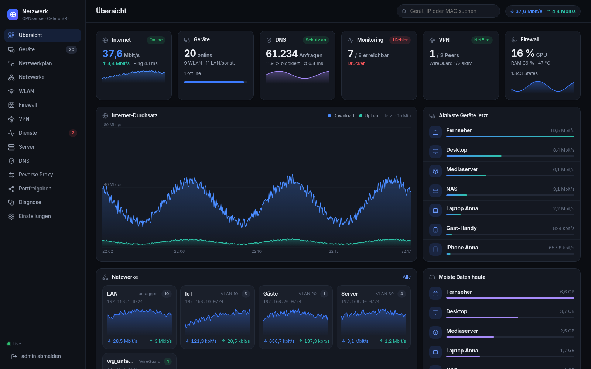
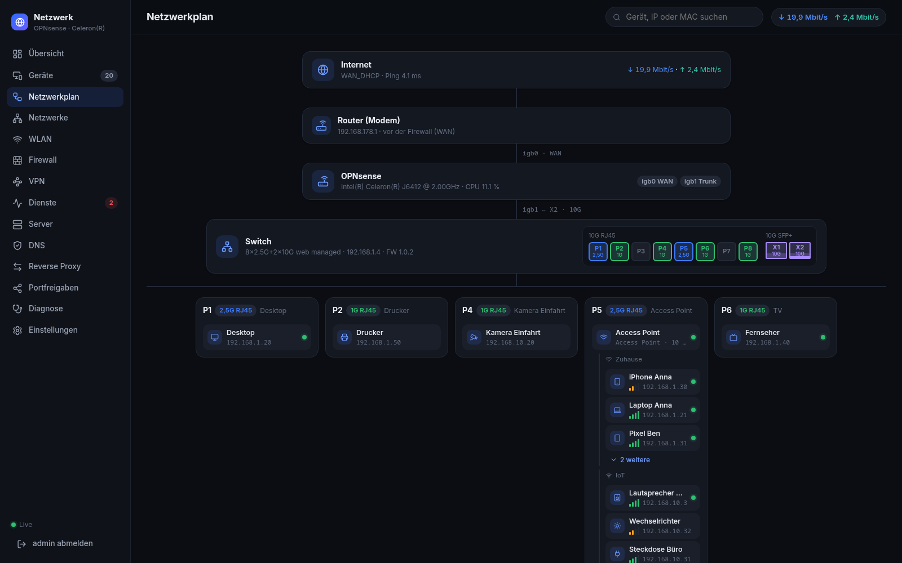
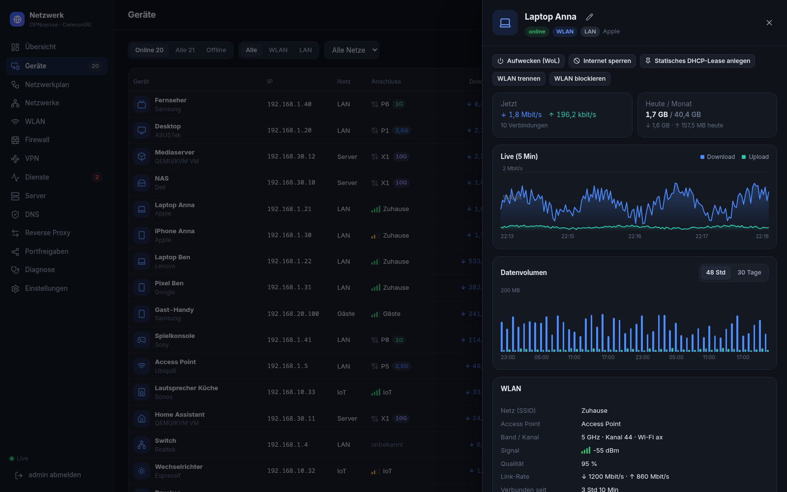
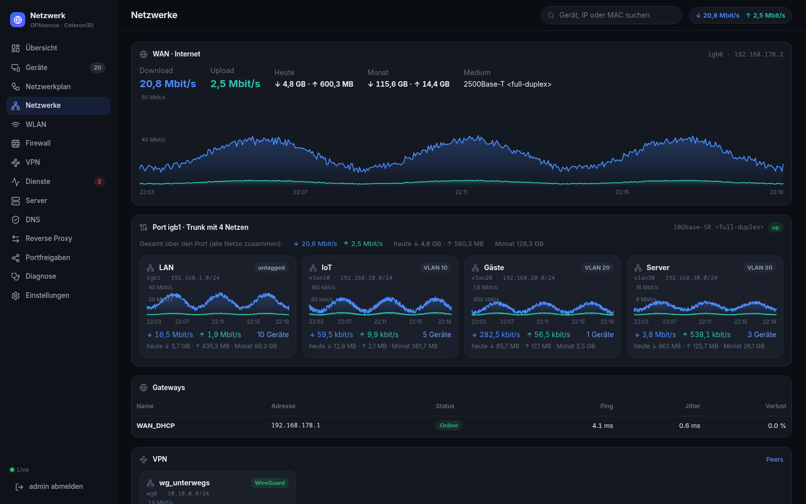
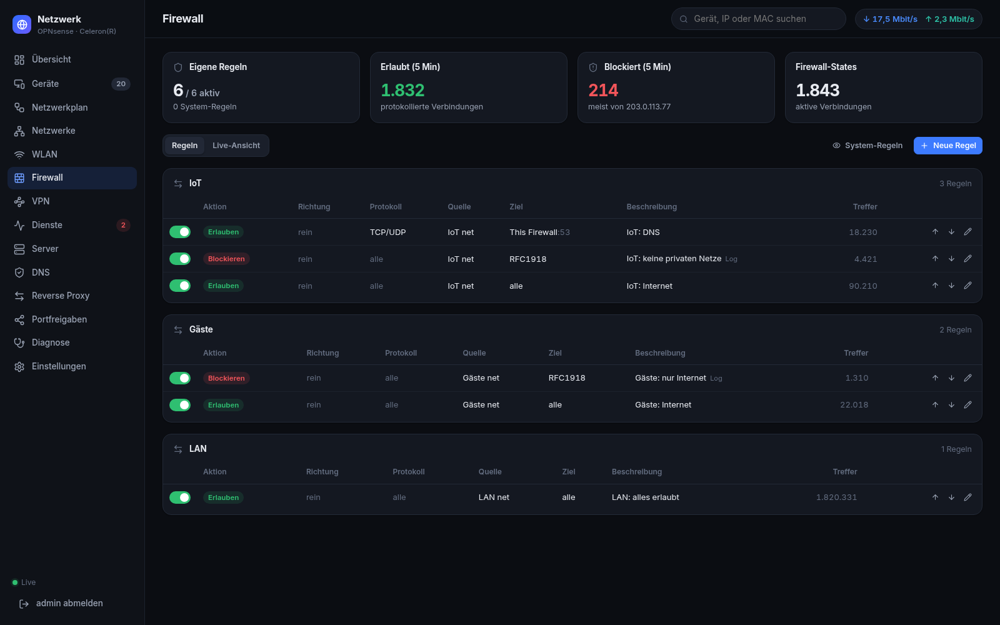
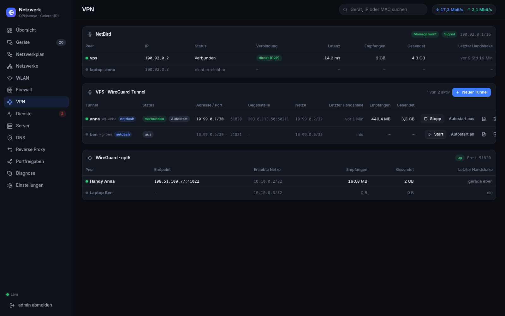
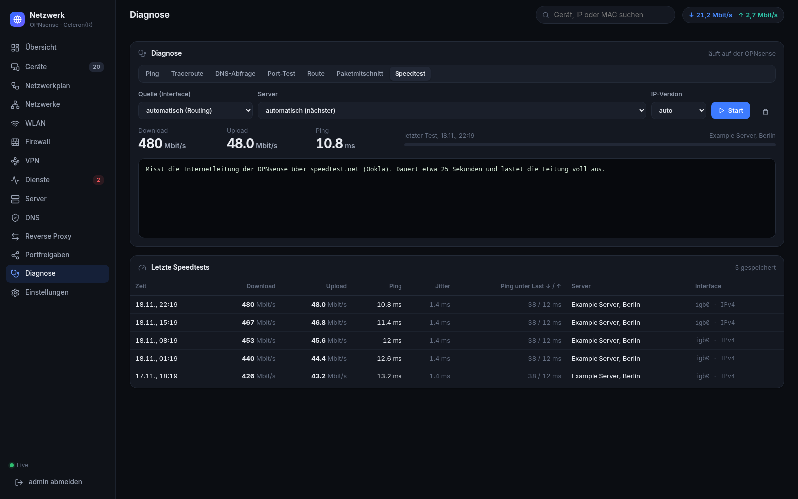
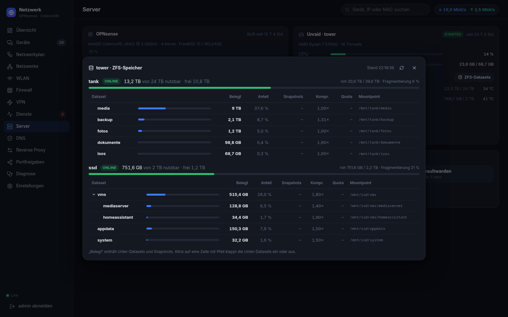

# netdash

A UniFi-style dashboard and settings board for **OPNsense**. It runs on the firewall itself, so it keeps
working when the rest of your homelab is down, and it pulls the important parts of OPNsense and the services
around it into one fast, live web app.



> All screenshots use simulated data from the demo server (`tools/demo/server.py`).
> The user interface is in **German** for now.

## Features

- **Devices**: every device in all networks with name, icon, IP, MAC, live up/down rate, traffic today and this
  month, DNS queries (AdGuard Home), WiFi quality, where it is plugged in (switch port or access point), online since.
  Rename, change the icon, Wake-on-LAN, static DHCP lease, block internet access.
- **Network map**: internet → upstream router → OPNsense → switch → ports → devices, with WiFi clients under
  their access point. Devices with an unknown location can be placed by hand.
- **Networks**: WAN, trunk ports with their VLANs (untagged traffic shown separately), VPN interfaces, loopback,
  gateways, with live charts.
- **Firewall**: rules grouped by interface, toggle, edit, create, reorder; live log. Every change is journaled and
  rolled back automatically after 60 s unless the browser confirms it is still connected.
- **Reverse proxy**: one form creates the four nginx plugin objects and, if you want, the AdGuard DNS rewrite.
- **Services**: OPNsense services with start/stop/restart, Gatus monitoring checks (create, edit, delete).
- **VPN**: NetBird peers, OPNsense WireGuard peers, WireGuard tunnels on a VPS (create one with a name and get
  the finished client config as file and QR code).
- **Diagnostics**: ping, traceroute, DNS lookup, TCP port test, route lookup, packet capture with export for
  Wireshark (pcap), speedtest (speedtest.net CLI, downloaded on request), each with a selectable source interface.
- **Servers**: OPNsense system, Unraid (CPU, RAM, pools, Docker, ZFS dataset usage).
- **Switch**: port status, description, speed, VLAN membership for Realtek-based web-managed switches.

<table>
  <tr>
    <td></td>
    <td></td>
  </tr>
  <tr>
    <td></td>
    <td></td>
  </tr>
  <tr>
    <td></td>
    <td></td>
  </tr>
  <tr>
    <td></td>
    <td></td>
  </tr>
</table>

## Install

Tested on OPNsense 26.7 (FreeBSD 15, amd64). netdash is a plugin package from its own repository, so after one
command it shows up in the regular plugin list and updates like any other plugin.

1. Add the package repository. On the OPNsense shell (SSH, or console option 8):

   ```sh
   pkg add https://noronus.github.io/netdash/os-netdash-repo.pkg
   ```

   This installs `os-netdash-repo`: the repository definition and its signing fingerprint.
2. In the web GUI open **System → Firmware → Plugins**, reload the list and install **os-netdash**.
3. Open **Services → netdash** (or `https://<LAN address of the firewall>:8098/`) and sign in with an
   OPNsense administrator account.
4. Create an API key for netdash: **System → Access → Users**, edit an administrator (or a dedicated user with full
   rights), **API keys → +**. Enter key and secret in netdash under **Einstellungen → Integrationen → OPNsense-API**.
   Without it the services, gateways, firewall rules and the reverse proxy stay empty.

Updates arrive through **System → Firmware → Plugins** like any other plugin. Removing `os-netdash` keeps your data in
`/usr/local/netdash/data`, the integration settings in `/usr/local/netdash/secrets.json` and `/usr/local/etc/netdash.conf`.

## Configuration

`/usr/local/etc/netdash.conf` (JSON, created on first install):

| Key      | Default | Meaning |
|----------|---------|---------|
| `listen` | `"lan"` | `"lan"` = LAN address of the firewall, `"0.0.0.0"`, `"127.0.0.1"` or any address |
| `port`   | `8098`  | TCP port |
| `tls`    | `true`  | HTTPS with the web GUI certificate (or a self-signed one if the GUI has none) |
| `url`    | `""`    | address the menu entry opens, e.g. when netdash sits behind a reverse proxy |

Restart after a change: **System → Diagnostics → Services → netdash**, or `configctl netdash restart`.

**Behind a reverse proxy** (for example the nginx plugin with your own domain and certificate): set
`"listen": "127.0.0.1"`, `"tls": false`, `"url": "https://net.example.com"` and proxy to `http://127.0.0.1:8098` with
buffering off (the UI uses server-sent events). The session cookie is `Secure`, so the browser must reach netdash over HTTPS.

Only administrators can sign in (privilege "All pages"). Sessions last 30 days.

## Integrations

Everything except the OPNsense API is optional. Settings are made in the UI (**Einstellungen → Integrationen**) and
take effect without a restart.

| Integration | Needs |
|-------------|-------|
| OPNsense API | API key + secret (see Install). The URL is detected from the web GUI settings. |
| AdGuard Home | the AdGuard Home plugin; URL, user, password. The query log is read directly from disk. |
| UniFi | UniFi Network application (UniFi OS); a local read/write user. WiFi clients, access points, WLAN settings. |
| Gatus | a Gatus instance; URL. To edit checks from netdash, Gatus must read its whole config directory `<dir>/config` (netdash writes `50-netdash.yaml`). |
| Unraid | Unraid API key with role VIEWER (GraphQL URL `http://<unraid>/graphql`). For the ZFS popup see below. |
| Switch | Realtek-based web-managed switch with the common `cgi/get.cgi` web UI; URL, user, password. |
| NetBird | the NetBird plugin (uses the local CLI). |
| VPS | a Linux server with a public IP and the helper from [`extras/vps`](extras/vps/README.md): port forwards, WireGuard tunnels, interface counters. |

Also used when present: `os-wol` (Wake-on-LAN), `os-nginx` (reverse proxy), dnsmasq (static DHCP leases).

**Unraid ZFS popup**: netdash reads `zpool list` / `zfs list` over SSH with a key that can do nothing else.

```sh
# on the OPNsense
ssh-keygen -t ed25519 -N '' -C netdash-zfs -f /usr/local/netdash/unraid_ed25519
cat /usr/local/netdash/unraid_ed25519.pub
```

Add the public key on Unraid to `/boot/config/ssh/root/authorized_keys`, as one line (replace the address with the one
the OPNsense uses to reach Unraid):

```
from="192.168.1.1",restrict,command="zpool list -Hp -o name,size,alloc,free,frag,cap,health; echo ---; zfs list -Hp -o name,used,avail,refer,usedbysnapshots,usedbychildren,compressratio,quota,type,mountpoint -t filesystem,volume" ssh-ed25519 AAAA... netdash-zfs
```

## Security notes

- netdash runs as root on the firewall: it reads pf states, the config and the DHCP leases, and starts `tcpdump`,
  `ping` and friends. Inputs for these tools are validated and passed as argument lists, never through a shell.
- Integration secrets live in `/usr/local/netdash/secrets.json` (mode 600) and are never sent to the browser.
- Write actions on the firewall go through the OPNsense API with your key. Firewall rule changes roll back on their own
  unless confirmed; switch, VPS and WireGuard changes refuse obviously dangerous cases (uplink port, address clashes).

## Development

```sh
cd frontend && npm ci && npm run build && cd ..
python3 tools/demo/server.py            # UI with simulated data on http://127.0.0.1:8090
OPN_HOST=root@192.168.1.1 ./deploy.sh   # copy backend, plugin files and frontend to a test box over SSH
```

- `backend/`: Python 3 standard library only (the OPNsense Python), one process, SQLite.
- `frontend/`: React + TypeScript + Vite.
- `plugin/src/`: files installed below `/usr/local` (rc.d service, configd actions, menu entry, ACL).
- `tools/build-pkg.sh VERSION OUTDIR [KEY]`: builds the packages and the repository on FreeBSD; the release workflow
  runs it in a FreeBSD VM for every `v*` tag and publishes the signed repository on GitHub Pages.

## License

MIT, see [LICENSE](LICENSE). The speedtest uses the Speedtest CLI by Ookla, which is not part of this project; it is
downloaded from Ookla on request and subject to their license (personal, non-commercial use).
